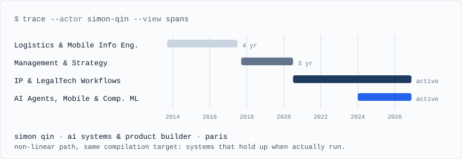

<picture>
  <source media="(prefers-color-scheme: dark)" srcset="https://raw.githubusercontent.com/sinonchum/sinonchum/main/trace-dark.svg">
  <source media="(prefers-color-scheme: light)" srcset="https://raw.githubusercontent.com/sinonchum/sinonchum/main/trace-light.svg">
  
</picture>

I turn dense, opaque workflows into software that actually runs. Most of my work sits at the intersection of agentic orchestration, European IP/legaltech, on-device Android systems, and applied ML — with a preference for real builds, deterministic verifiers, and honest metrics over slideware.

Half my week is teaching AI agents to work autonomously; the other half is politely asking them to stop being creative with my production config.

## Agent systems & applied AI

| Repo | What it is |
|---|---|
| [Feiyue](https://github.com/sinonchum/Feiyue) | Verification-gated AI development orchestrator built on Hermes Agent. Strong models specify, weak models execute, deterministic verifiers gate quality, and the system learns across runs. |
| [WhatThePhoques](https://github.com/sinonchum/WhatThePhoques) | Team repo for the European AI Championship Paris (Nov 2026): image watermark localization (`0.7897` public LB via 43 clean OOF models, `TruFor`/`MMFusion` forensics, `DINOv2-Large` refiners, and `SAM-1 ViT-H`), model equality testing (`1.00` public LB), and machine unlearning (`0.3433` public LB). |
| [callpilot](https://github.com/sinonchum/callpilot) | Rooted Android phone-call agent that transcribes live calls and acts on calendar and notes through a custom on-device click loop. Built at the H Company x 42AI Computer Use Agents Hackathon. |
| [hermes-mobile](https://github.com/sinonchum/hermes-mobile) | Android client for Hermes Agent with persistent cross-session memory, autonomous skill creation, and local LLM fallback. |
| [pluribus-for-codex](https://github.com/sinonchum/pluribus-for-codex) | Shared, evidence-backed working memory layer for coordinating multiple Codex agents without clobbering state. |
| [NeuroOntoGen](https://github.com/sinonchum/NeuroOntoGen) | SDK-first ontology generation that refuses to trust raw LLM output: models propose ABox facts, while LinkML, Pydantic, RDF, and SHACL decide what survives. |

## LegalTech & structured workflows

| Repo | What it is |
|---|---|
| [PatentFlow](https://github.com/sinonchum/PatentFlow) | Privacy-first agentic workspace for European Patent Attorneys (Next.js, FastAPI, Celery, local LLM). Parses EPO Office Actions and drafts standard-compliant responses locally to keep client disclosures off third-party APIs. |
| [TradeMarkFlow-EU](https://github.com/sinonchum/TradeMarkFlow-EU) | Privacy-first EU trademark analysis and clearance system built on FastAPI, LanceDB, and Agno agents. |
| [tech-catcher](https://github.com/sinonchum/tech-catcher) | Patent intelligence dashboard for the energy sector combining EPO OPS and Google Patents ingestion with Scrapling anti-bot handling. |

## Mobile, local AI & low-level tinkering

| Repo | What it is |
|---|---|
| [TransLite](https://github.com/sinonchum/TransLite) | Offline-first Android translation app (ML Kit, Jetpack Compose, Material 3) built as a local-inference boundary for network-constrained moments. |
| [Telemetriq](https://github.com/sinonchum/Telemetriq) | Open-source TypeScript/React visualization framework for high-frequency spatial time-series telemetry in the browser. |
| [lens-coach](https://github.com/sinonchum/lens-coach) | Android AI camera coach offering live framing, focal-length, and composition guidance. |
| [coloros-google-lpa-esim](https://github.com/sinonchum/coloros-google-lpa-esim) | Temporarily elevates Google SIM Manager as a privileged LPA on locked-bootloader ColorOS (KernelSU + Shark) to provision GSMA confirmation-code eSIMs — no unlock, no brick. |
| [altitude](https://github.com/sinonchum/altitude) | Offline sea-level altitude display and bottom-bar photo watermarker for Android in Kotlin. |

## Elsewhere

Building **VOYAGERAI**, an offline-first AI travel command layer spanning web planning, mobile field execution, and a shared SDK. Also maintaining tooling around the Hermes Agent ecosystem ([AppShip](https://github.com/sinonchum/AppShip), [Hermes-GSpace](https://github.com/sinonchum/Hermes-GSpace), [hermes-cursor-agent-cli](https://github.com/sinonchum/hermes-cursor-agent-cli), [voyagerai-hermes](https://github.com/sinonchum/voyagerai-hermes)).

## Contact

[Website](https://sinonchum.github.io) · [LinkedIn](https://www.linkedin.com/in/fsimonq-public) · [f.simon.qin@gmail.com](mailto:f.simon.qin@gmail.com)
